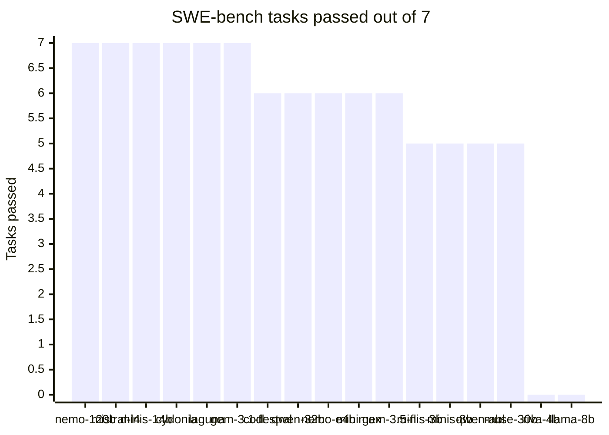
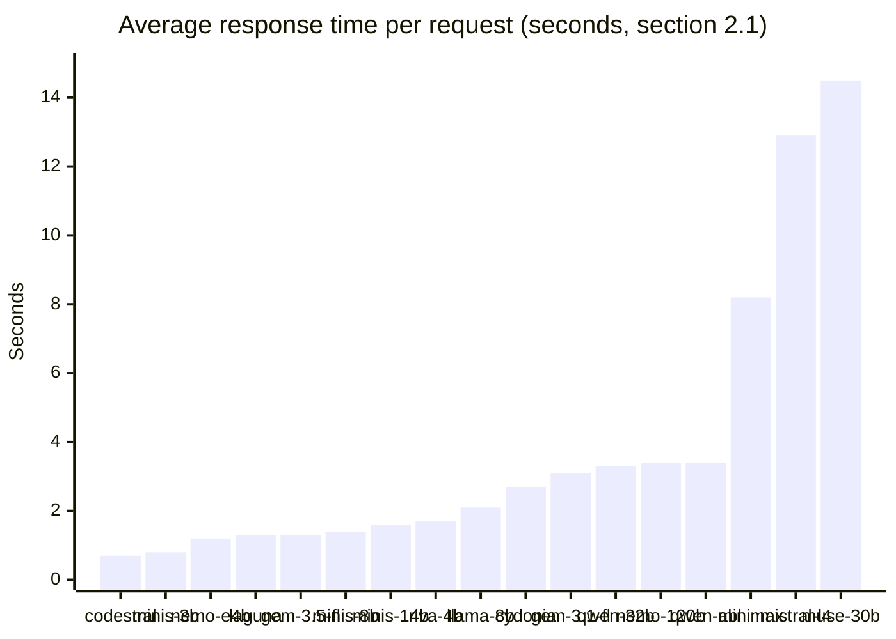
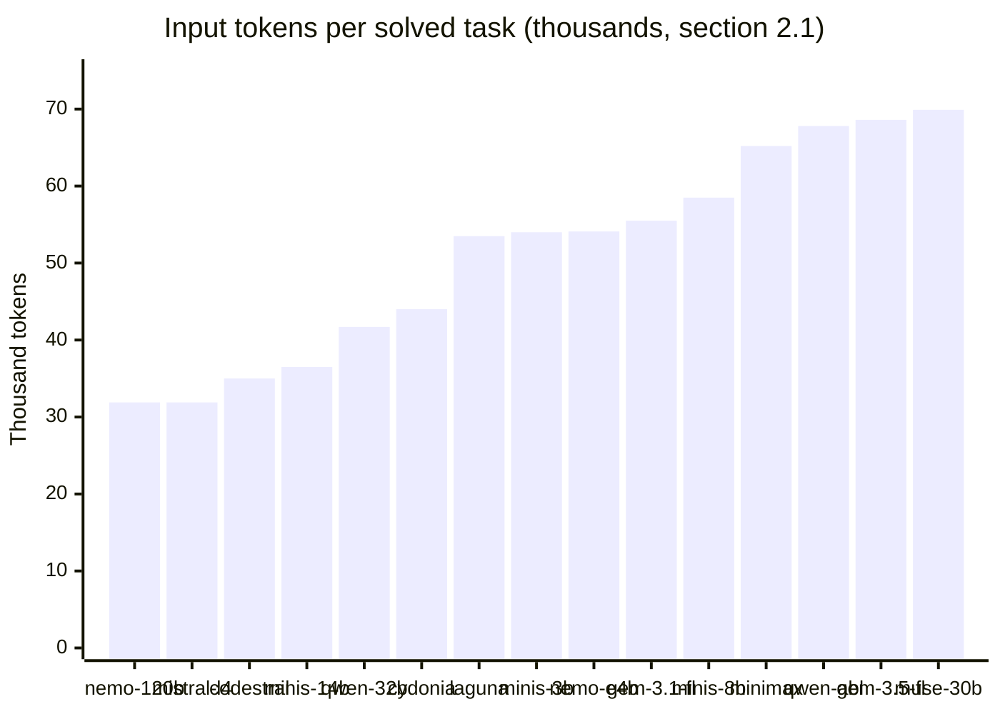

# Benchmark Report

> Each cell is a single run, so there is no variance estimate, except where a
> section says otherwise (5.2, 10.6).

## 1. Setup

**Agent**: `agent_swebench` (Thought → Code → Observation loop, MCP tools
running in the task's Docker container). Same prompt, tools and limits for
every run of sections 2 to 5: 30 iterations, 300,000 input tokens, 10,000
output tokens, 900 s, 400 tokens max per model reply. The agent stops its own
loop after 540 s (900 s minus a 360 s margin for submission and container
cleanup). No sampling parameter (temperature, top_p) is sent, so each provider
uses its own default.

The report has two rounds of SWE-bench runs:
- **Main comparison (section 2.1)**: 17 models, 3 providers, the same 7
  tasks. Backing files in `bench/final/`.
- **First round (section 2.2)**: 5 models, 2 providers, 3 tasks, produced
  before the multi-format tool-call extraction (`agent/extract.py`) was added
  to the agent, and not re-run with it. Backing files in `bench/`.

The runs of 2.1 were not all made with the same version of the code. Table
1.3 says which version each group used.

**1.1 Providers / models**

| Provider | Model (short name in the tables) | Developer | Tasks |
|---|---|---|---|
| Google (Gemini) | `gemini-3.1-flash-lite` | Google | 7 |
| Google (Gemini) | `gemini-3.5-flash-lite` | Google | 7 |
| Mistral | `ministral-8b-latest` | Mistral | 7 |
| Mistral | `ministral-14b-latest` | Mistral | 7 |
| Mistral | `ministral-3b-latest` | Mistral | 7 |
| Mistral | `codestral-latest` | Mistral | 7 |
| NVIDIA, catalogue | `mistralai/mistral-large-4-1t-a52b` (`mistral-large-4-1t`) | Mistral | 7 |
| NVIDIA, catalogue | `nvidia/nemotron-3.5-super-vl-120b-a12b` (`nemotron-3.5-super-120b`) | NVIDIA | 7 |
| NVIDIA, catalogue | `nvidia/nemotron-3.5-bolt-e4b` | NVIDIA | 7 |
| NVIDIA, catalogue | `poolside/laguna-xs-2.1` (`laguna-xs-2.1`) | Poolside, code model | 7 |
| NVIDIA, catalogue | `minimaxai/minimax-m3.1-flash` (`minimax-m3.1-flash`) | MiniMax | 7 |
| NVIDIA, catalogue | `meta/muse-glimmer-30b` (`muse-glimmer-30b`) | Meta | 7 |
| NVIDIA, deployed | `Qwen/Qwen2.5-Coder-32B-Instruct` (`qwen2.5-coder-32b-instruct`) | Alibaba (Qwen team) | 7 |
| NVIDIA, deployed | `TobiasLogic/Qwen2.5-Coder-32B-abliterated` (`qwen2.5-coder-32b-abliterated`) | TobiasLogic, abliterated version of the model above | 7 |
| NVIDIA, deployed | `TheDrummer/Cydonia-24B-v4.3` (`cydonia-24b-v4.3`) | TheDrummer, community fine-tune of Mistral Small 24B | 7 |
| NVIDIA, deployed | `DavidAU/Llama3.3-8B-Instruct-Thinking-Heretic-Uncensored-Claude-4.5-Opus-High-Reasoning` (`llama3.3-8b-thinking`) | DavidAU, community fine-tune of a Llama (Meta) model | 7 |
| NVIDIA, deployed | `nvidia/Riva-Translate-4B-Instruct` (`riva-translate-4b`) | NVIDIA, translation model | 7 |
| Google (Gemini) | `gemini-3-flash-preview` | Google | 2, stopped by the free quota (2.3) |
| Google (Gemini) | `gemini-3.5-flash` | Google | 2 (+1 cut), stopped by the free quota (2.3) |

NVIDIA serves models in two ways, both free for development:
- **Catalogue**: `https://integrate.api.nvidia.com/v1` (the URL of
  `models_config.json`), models hosted by NVIDIA, no setup.
- **Deployed**: `https://nim.api.nvidia.com/v1`, a model the user starts from
  its build.nvidia.com page; it answers only while that deployment runs.

Groq (`qwen/qwen3.8-27b`) is used for MBPP only (section 7), so the SWE-bench
comparison covers 3 providers.

Tried and excluded:
- `mistral-large-4` on Mistral's own API: reasoning model. Its answer comes
  back as a list of blocks. In `bench/mistral-large-4__sympy-13480.json` the
  reply text was empty at step 1, then the request failed with HTTP 400 at
  step 2. In a separate test, 399 of 400 tokens went into reasoning and the
  reply was cut (`finish_reason: length`). The same model on NVIDIA's
  catalogue is benchmarked in 2.1 (section 10.10).
- `mistral-small-latest`, `mistral-medium-latest`: HTTP 429 with
  `x-ratelimit-limit-req-minute: 0` on our free-tier key, so no usable quota.
  The `mistral-small-latest` run ended with `all keys failed` and 0 iterations.
  Its file is not kept.
- `magistral-*`: not tried (reasoning models, same risk as `mistral-large-4`).
- `gemini-2.5-flash`: listed by the API, HTTP 404 at step 0.
- `gemini-3.6-flash`, `gemini-3.7-flash`, `gemini-3.8-flash`: listed by the
  API, but every request was rate-limited: 0 iterations on all 6 pool tasks,
  so no free quota for these models on our keys.
- `nicoboss/DeepSeek-R1-Distill-Qwen-32B-Uncensored` (deployed): listed and
  deployable on build.nvidia.com, but every request was refused with HTTP 403
  "Access Denied" and no reason given, so 0 iterations.
- NVIDIA catalogue: `google/gemma-3-4b-it` and `google/gemma-3-12b-it`
  answered 404, `google/gemma-4-31b-it` ended with `all keys failed`, all at
  step 0. Before the next runs, each candidate got one short chat request:
  `google/gemma-4-31b-it` and `openai/gpt-oss-20b` did not answer it, the 5
  catalogue models of 1.1 answered with HTTP 200. Some catalogue pages say
  the model is "published for preview and playground use only", so a model
  listed by `/v1/models` is not necessarily callable.

**1.2 Tasks** (SWE-bench Verified)

| Task | Repository | Bug |
|---|---|---|
| `sympy__sympy-13480` | sympy | typo `cotm` instead of `cothm` in `coth.eval` |
| `pydata__xarray-4629` | xarray | `merge(combine_attrs="override")` shares attrs with the first object |
| `sympy__sympy-14711` | sympy | `Vector + 0` raises `TypeError` |
| `django__django-11066` | django | `RenameContentType` saves on the default database instead of the one given |
| `scikit-learn__scikit-learn-13439` | scikit-learn | `Pipeline` has no `__len__` |
| `sympy__sympy-18189` | sympy | `diophantine` results depend on the order of `syms` when `permute=True` |
| `django__django-11099` | django | username validators accept a trailing newline (`$` instead of `\Z`) |

Selection rationale: the first three are the tasks the subject (section V.4)
recommends for initial testing. The first six are the moulinette's exam pool
(`EXAM_POOL`, see section 8), so the comparison is on the tasks the agent is
graded on. `django-11099` was added as a seventh task from outside the pool:
another repository area (django auth), and a fix whose line appears twice in
the file, which tests how a model handles `edit_file`'s "old_str must be
unique" rule. Using the same tasks for every model keeps the comparison fair.
They are not equally easy for our agent: sympy-14711 takes 8 to 30
iterations, where most other runs take 4 to 12 (section 2.1).

**1.3 Code version of each group of runs**

| Group | Date | Code |
|---|---|---|
| `gemini-3.1-flash-lite`, 6 pool tasks (also 8.3) | 7 November | commit `3c7d559` |
| `gemini-3.5-flash-lite`, 6 pool tasks | 12 November, 03:13 to 03:21 | between `2ea343b` and `09b1014` |
| Every other run of 2.1: all runs on `django-11099`, all NVIDIA and Mistral models | 13 November, 00:16 to 10:35 | commit `9805ceb` (plus the NVIDIA entry of `models_config.json`) |

Between `3c7d559` and `9805ceb`: the tool paths starting with `/testbed` are
mapped to the repository root and `final_answer` no longer raises
(`ae9d3fe`), the sandbox rejects code that redefines a tool name (`2ea343b`),
the SWE-bench prompt was reworded without changing its rules (`09b1014`), and
the sandbox memory limit was corrected (`9805ceb`). Limits and tool set are
the same.

**Validation**: every solution file is checked with `moulinette_eval validate`
(correctness + metrics). Pass/Fail in this report is the moulinette result,
not the agent's own `success` field.

## 2. Results

### 2.1 Main comparison (7 tasks)

| Model | Provider | sympy-13480 | xarray-4629 | sympy-14711 | django-11066 | scikit-learn-13439 | sympy-18189 | django-11099 | Total |
|---|---|---|---|---|---|---|---|---|---|
| nemotron-3.5-super-120b | NVIDIA (catalogue) | PASS | PASS | PASS | PASS | PASS | PASS | PASS | 7/7 |
| mistral-large-4-1t | NVIDIA (catalogue) | PASS | PASS | PASS | PASS | PASS | PASS | PASS | 7/7 |
| ministral-14b-latest | Mistral | PASS | PASS | PASS | PASS | PASS | PASS | PASS | 7/7 |
| cydonia-24b-v4.3 | NVIDIA (NIM, deployed) | PASS | PASS | PASS | PASS | PASS | PASS | PASS | 7/7 |
| laguna-xs-2.1 | NVIDIA (catalogue) | PASS | PASS | PASS | PASS | PASS | PASS | PASS | 7/7 |
| gemini-3.1-flash-lite | Google | PASS | PASS | PASS | PASS | PASS | PASS | PASS | 7/7 |
| codestral-latest | Mistral | PASS | PASS | fail (rate limit) | PASS | PASS | PASS | PASS | 6/7 |
| qwen2.5-coder-32b-instruct | NVIDIA (NIM, deployed) | PASS | PASS | PASS | PASS | fail | PASS | PASS | 6/7 |
| nemotron-3.5-bolt-e4b | NVIDIA (catalogue) | PASS | PASS | PASS | PASS | PASS | PASS | fail | 6/7 |
| minimax-m3.1-flash | NVIDIA (catalogue) | PASS | PASS | fail | PASS | PASS | PASS | PASS | 6/7 |
| gemini-3.5-flash-lite | Google | PASS | PASS | fail | PASS | PASS | PASS | PASS | 6/7 |
| ministral-3b-latest | Mistral | PASS | PASS | fail (rate limit) | PASS | PASS | PASS | fail (rate limit) | 5/7 |
| ministral-8b-latest | Mistral | PASS | PASS | fail (rate limit) | PASS | fail (rate limit) | PASS | PASS | 5/7 |
| qwen2.5-coder-32b-abliterated | NVIDIA (NIM, deployed) | PASS | PASS | fail | PASS | PASS | PASS | fail | 5/7 |
| muse-glimmer-30b | NVIDIA (catalogue) | PASS | PASS | fail | PASS | fail | PASS | PASS | 5/7 |
| riva-translate-4b | NVIDIA (NIM, deployed) | fail | fail | fail | fail | fail | fail | fail | 0/7 |
| llama3.3-8b-thinking | NVIDIA (NIM, deployed) | fail | fail | fail | fail | fail | fail | fail | 0/7 |

"fail (rate limit)": the run reached the agent's 540 s time budget because
Mistral's free tier made it wait about 60 s after every 2 requests (section
3). It counts as a failure, since a run that exceeds a limit fails (subject
VI.1). The night runs gave 7 such failures; all 7 were run again later
that morning. 2 passed (`ministral-14b-latest` on django-11066, `codestral-latest`
on django-11099) and replace the night runs in the grid; the other 5 hit the
same limit a second time. Both runs of each cell are in `bench/rerun/`.



Full results:

| Model | Task | Pass | Iterations | Input tokens | Output tokens | Time (s) |
|---|---|---|---|---|---|---|
| nemotron-3.5-super-120b | sympy-13480 | PASS | 4 | 13,895 | 285 | 13.2 |
| nemotron-3.5-super-120b | xarray-4629 | PASS | 4 | 17,268 | 464 | 13.7 |
| nemotron-3.5-super-120b | sympy-14711 | PASS | 17 | 65,370 | 2,638 | 76.2 |
| nemotron-3.5-super-120b | django-11066 | PASS | 4 | 16,116 | 439 | 15.2 |
| nemotron-3.5-super-120b | scikit-learn-13439 | PASS | 9 | 38,686 | 1,166 | 33.4 |
| nemotron-3.5-super-120b | sympy-18189 | PASS | 9 | 43,307 | 908 | 63.0 |
| nemotron-3.5-super-120b | django-11099 | PASS | 8 | 28,327 | 842 | 57.3 |
| mistral-large-4-1t | sympy-13480 | PASS | 7 | 21,641 | 468 | 36.3 |
| mistral-large-4-1t | xarray-4629 | PASS | 10 | 40,912 | 988 | 144.3 |
| mistral-large-4-1t | sympy-14711 | PASS | 12 | 39,166 | 1,464 | 75.2 |
| mistral-large-4-1t | django-11066 | PASS | 6 | 22,468 | 364 | 161.7 |
| mistral-large-4-1t | scikit-learn-13439 | PASS | 11 | 38,198 | 987 | 349.4 |
| mistral-large-4-1t | sympy-18189 | PASS | 7 | 27,332 | 623 | 113.3 |
| mistral-large-4-1t | django-11099 | PASS | 10 | 33,482 | 688 | 137.0 |
| ministral-14b-latest | sympy-13480 | PASS | 4 | 13,827 | 180 | 76.1 |
| ministral-14b-latest | xarray-4629 | PASS | 5 | 21,238 | 251 | 137.8 |
| ministral-14b-latest | sympy-14711 | PASS | 16 | 63,084 | 1,101 | 457.0 |
| ministral-14b-latest | django-11066 | PASS | 11 | 43,429 | 673 | 270.2 |
| ministral-14b-latest | scikit-learn-13439 | PASS | 12 | 49,774 | 638 | 327.7 |
| ministral-14b-latest | sympy-18189 | PASS | 5 | 21,262 | 288 | 154.2 |
| ministral-14b-latest | django-11099 | PASS | 13 | 42,560 | 727 | 332.5 |
| cydonia-24b-v4.3 | sympy-13480 | PASS | 4 | 13,622 | 197 | 19.7 |
| cydonia-24b-v4.3 | xarray-4629 | PASS | 9 | 38,613 | 369 | 32.4 |
| cydonia-24b-v4.3 | sympy-14711 | PASS | 24 | 103,801 | 1,515 | 78.8 |
| cydonia-24b-v4.3 | django-11066 | PASS | 6 | 22,476 | 274 | 27.5 |
| cydonia-24b-v4.3 | scikit-learn-13439 | PASS | 12 | 46,101 | 611 | 42.3 |
| cydonia-24b-v4.3 | sympy-18189 | PASS | 7 | 29,066 | 380 | 44.9 |
| cydonia-24b-v4.3 | django-11099 | PASS | 16 | 54,404 | 818 | 50.4 |
| laguna-xs-2.1 | sympy-13480 | PASS | 6 | 20,850 | 269 | 13.7 |
| laguna-xs-2.1 | xarray-4629 | PASS | 10 | 41,954 | 217 | 17.6 |
| laguna-xs-2.1 | sympy-14711 | PASS | 23 | 109,896 | 974 | 31.3 |
| laguna-xs-2.1 | django-11066 | PASS | 6 | 23,602 | 246 | 14.2 |
| laguna-xs-2.1 | scikit-learn-13439 | PASS | 23 | 116,452 | 2,220 | 57.1 |
| laguna-xs-2.1 | sympy-18189 | PASS | 7 | 33,608 | 385 | 47.4 |
| laguna-xs-2.1 | django-11099 | PASS | 8 | 28,314 | 504 | 15.5 |
| gemini-3.1-flash-lite | sympy-13480 | PASS | 8 | 29,044 | 843 | 21.1 |
| gemini-3.1-flash-lite | xarray-4629 | PASS | 7 | 30,740 | 509 | 18.2 |
| gemini-3.1-flash-lite | sympy-14711 | PASS | 28 | 143,803 | 3,635 | 155.7 |
| gemini-3.1-flash-lite | django-11066 | PASS | 6 | 24,624 | 312 | 27.7 |
| gemini-3.1-flash-lite | scikit-learn-13439 | PASS | 20 | 96,864 | 1,514 | 99.3 |
| gemini-3.1-flash-lite | sympy-18189 | PASS | 6 | 27,506 | 430 | 38.0 |
| gemini-3.1-flash-lite | django-11099 | PASS | 9 | 35,588 | 683 | 55.7 |
| codestral-latest | sympy-13480 | PASS | 5 | 17,253 | 177 | 133.4 |
| codestral-latest | xarray-4629 | PASS | 6 | 23,767 | 197 | 134.1 |
| codestral-latest | sympy-14711 | FAIL | 17 | 60,963 | 989 | 563.0 |
| codestral-latest | django-11066 | PASS | 7 | 25,845 | 250 | 194.1 |
| codestral-latest | scikit-learn-13439 | PASS | 8 | 26,940 | 305 | 192.9 |
| codestral-latest | sympy-18189 | PASS | 5 | 20,671 | 180 | 147.7 |
| codestral-latest | django-11099 | PASS | 10 | 34,735 | 488 | 261.2 |
| qwen2.5-coder-32b-instruct | sympy-13480 | PASS | 4 | 13,196 | 149 | 21.3 |
| qwen2.5-coder-32b-instruct | xarray-4629 | PASS | 6 | 22,447 | 222 | 27.7 |
| qwen2.5-coder-32b-instruct | sympy-14711 | PASS | 15 | 52,434 | 763 | 58.8 |
| qwen2.5-coder-32b-instruct | django-11066 | PASS | 4 | 14,490 | 152 | 19.0 |
| qwen2.5-coder-32b-instruct | scikit-learn-13439 | FAIL | 14 | 62,385 | 598 | 63.9 |
| qwen2.5-coder-32b-instruct | sympy-18189 | PASS | 4 | 16,598 | 183 | 35.6 |
| qwen2.5-coder-32b-instruct | django-11099 | PASS | 19 | 68,771 | 1,258 | 79.4 |
| nemotron-3.5-bolt-e4b | sympy-13480 | PASS | 5 | 17,802 | 238 | 14.7 |
| nemotron-3.5-bolt-e4b | xarray-4629 | PASS | 8 | 37,112 | 417 | 17.4 |
| nemotron-3.5-bolt-e4b | sympy-14711 | PASS | 8 | 28,956 | 510 | 15.7 |
| nemotron-3.5-bolt-e4b | django-11066 | PASS | 6 | 25,304 | 328 | 14.3 |
| nemotron-3.5-bolt-e4b | scikit-learn-13439 | PASS | 6 | 22,833 | 417 | 13.6 |
| nemotron-3.5-bolt-e4b | sympy-18189 | PASS | 9 | 43,828 | 536 | 50.9 |
| nemotron-3.5-bolt-e4b | django-11099 | FAIL | 30 | 148,902 | 2,505 | 51.0 |
| minimax-m3.1-flash | sympy-13480 | PASS | 8 | 31,652 | 959 | 45.5 |
| minimax-m3.1-flash | xarray-4629 | PASS | 6 | 24,565 | 509 | 156.1 |
| minimax-m3.1-flash | sympy-14711 | FAIL | 30 | 154,502 | 8,334 | 499.8 |
| minimax-m3.1-flash | django-11066 | PASS | 6 | 24,038 | 776 | 170.3 |
| minimax-m3.1-flash | scikit-learn-13439 | PASS | 19 | 80,340 | 3,372 | 320.8 |
| minimax-m3.1-flash | sympy-18189 | PASS | 7 | 29,102 | 912 | 128.5 |
| minimax-m3.1-flash | django-11099 | PASS | 13 | 46,785 | 2,108 | 160.1 |
| gemini-3.5-flash-lite | sympy-13480 | PASS | 5 | 18,358 | 539 | 16.7 |
| gemini-3.5-flash-lite | xarray-4629 | PASS | 5 | 23,080 | 190 | 16.9 |
| gemini-3.5-flash-lite | sympy-14711 | FAIL | 30 | 183,007 | 2,934 | 108.4 |
| gemini-3.5-flash-lite | django-11066 | PASS | 5 | 20,804 | 236 | 14.4 |
| gemini-3.5-flash-lite | scikit-learn-13439 | PASS | 20 | 100,831 | 1,202 | 80.5 |
| gemini-3.5-flash-lite | sympy-18189 | PASS | 4 | 18,943 | 221 | 26.4 |
| gemini-3.5-flash-lite | django-11099 | PASS | 12 | 46,576 | 616 | 26.0 |
| ministral-3b-latest | sympy-13480 | PASS | 4 | 13,787 | 153 | 73.0 |
| ministral-3b-latest | xarray-4629 | PASS | 7 | 27,806 | 313 | 194.4 |
| ministral-3b-latest | sympy-14711 | FAIL | 19 | 73,933 | 1,796 | 563.6 |
| ministral-3b-latest | django-11066 | PASS | 9 | 34,267 | 409 | 254.3 |
| ministral-3b-latest | scikit-learn-13439 | PASS | 10 | 35,265 | 566 | 316.6 |
| ministral-3b-latest | sympy-18189 | PASS | 5 | 21,006 | 280 | 146.9 |
| ministral-3b-latest | django-11099 | FAIL | 19 | 63,782 | 1,769 | 565.9 |
| ministral-8b-latest | sympy-13480 | PASS | 4 | 13,812 | 203 | 75.0 |
| ministral-8b-latest | xarray-4629 | PASS | 6 | 23,831 | 281 | 133.9 |
| ministral-8b-latest | sympy-14711 | FAIL | 20 | 83,384 | 2,510 | 589.9 |
| ministral-8b-latest | django-11066 | PASS | 5 | 19,199 | 275 | 133.7 |
| ministral-8b-latest | scikit-learn-13439 | FAIL | 19 | 79,223 | 1,249 | 570.8 |
| ministral-8b-latest | sympy-18189 | PASS | 7 | 29,480 | 476 | 212.0 |
| ministral-8b-latest | django-11099 | PASS | 13 | 43,580 | 891 | 326.6 |
| qwen2.5-coder-32b-abliterated | sympy-13480 | PASS | 4 | 13,240 | 166 | 22.2 |
| qwen2.5-coder-32b-abliterated | xarray-4629 | PASS | 4 | 15,276 | 131 | 20.7 |
| qwen2.5-coder-32b-abliterated | sympy-14711 | FAIL | 30 | 136,330 | 1,742 | 118.0 |
| qwen2.5-coder-32b-abliterated | django-11066 | PASS | 5 | 17,867 | 172 | 23.2 |
| qwen2.5-coder-32b-abliterated | scikit-learn-13439 | PASS | 5 | 16,429 | 177 | 23.0 |
| qwen2.5-coder-32b-abliterated | sympy-18189 | PASS | 5 | 19,929 | 193 | 38.4 |
| qwen2.5-coder-32b-abliterated | django-11099 | FAIL | 30 | 120,134 | 1,705 | 110.7 |
| muse-glimmer-30b | sympy-13480 | PASS | 9 | 30,813 | 654 | 312.0 |
| muse-glimmer-30b | xarray-4629 | PASS | 6 | 23,040 | 296 | 60.8 |
| muse-glimmer-30b | sympy-14711 | FAIL | 19 | 79,704 | 2,473 | 573.9 |
| muse-glimmer-30b | django-11066 | PASS | 4 | 15,240 | 284 | 56.4 |
| muse-glimmer-30b | scikit-learn-13439 | FAIL | 30 | 139,279 | 1,750 | 394.9 |
| muse-glimmer-30b | sympy-18189 | PASS | 8 | 34,145 | 632 | 147.8 |
| muse-glimmer-30b | django-11099 | PASS | 9 | 27,033 | 516 | 96.6 |
| riva-translate-4b | sympy-13480 | FAIL | 30 | 39,410 | 1,091 | 51.4 |
| riva-translate-4b | xarray-4629 | FAIL | 30 | 89,292 | 4,051 | 89.8 |
| riva-translate-4b | sympy-14711 | FAIL | 30 | 43,428 | 1,152 | 52.1 |
| riva-translate-4b | django-11066 | FAIL | 30 | 59,955 | 883 | 51.0 |
| riva-translate-4b | scikit-learn-13439 | FAIL | 30 | 44,067 | 738 | 47.4 |
| riva-translate-4b | sympy-18189 | FAIL | 30 | 64,601 | 903 | 50.8 |
| riva-translate-4b | django-11099 | FAIL | 30 | 26,312 | 226 | 41.4 |
| llama3.3-8b-thinking | sympy-13480 | FAIL | 30 | 113,367 | 1,094 | 61.0 |
| llama3.3-8b-thinking | xarray-4629 | FAIL | 30 | 148,887 | 2,749 | 82.6 |
| llama3.3-8b-thinking | sympy-14711 | FAIL | 30 | 99,668 | 652 | 54.3 |
| llama3.3-8b-thinking | django-11066 | FAIL | 30 | 130,571 | 1,736 | 70.0 |
| llama3.3-8b-thinking | scikit-learn-13439 | FAIL | 30 | 130,674 | 1,881 | 78.9 |
| llama3.3-8b-thinking | sympy-18189 | FAIL | 30 | 150,239 | 1,964 | 74.1 |
| llama3.3-8b-thinking | django-11099 | FAIL | 30 | 119,231 | 1,272 | 62.9 |

Pass count: 92 of 119 runs. Every row was validated with the moulinette on its
own solution file. The backing files are `bench/final/<model>__<task>.json`,
with the short model names of the tables.

Notes
- Every failure except one ends on `max_iterations` or `max_time`. The
  exception is `qwen2.5-coder-32b-instruct` on scikit-learn-13439: it called
  `final_answer` at step 14 with an empty patch (section 10.5).
- All 5 Mistral failures are the rate-limit timeouts above: 17 to 20
  iterations in 563 to 590 s, with 9 retries each, and 19 to 21 iterations in
  the second attempt. The Mistral runs that pass use at most 16 iterations.
  On the tasks they passed, the same models took 73 to 457 s, against 7 to
  48 s in the first round (2.2).
- `muse-glimmer-30b` fails sympy-14711 on `max_time` too, but with 2 retries:
  its replies took 23 s on average in that run, so the time went into the
  model's answers, not into waiting for the quota.
- sympy-14711 is the task that separates the models. Without the Mistral
  timeouts, it fails for 4 of the 15 models that pass anything
  (`gemini-3.5-flash-lite`, `qwen2.5-coder-32b-abliterated`,
  `minimax-m3.1-flash`, `muse-glimmer-30b`). The models that pass it use 8 to
  28 iterations.
- The 14711 patches of `nemotron-3.5-super-120b`, `nemotron-3.5-bolt-e4b`,
  `laguna-xs-2.1` and `mistral-large-4-1t` add `if other == 0: return self`,
  the fix the issue asks for. `cydonia-24b-v4.3` and `ministral-14b-latest`
  return the vector for any number, which passes the tests but is broader
  than the issue asks (`ministral-8b-latest` did the same in 2.2).
- `llama3.3-8b-thinking` and `riva-translate-4b` fail all 7 tasks for
  different reasons (sections 10.3 and 10.4).

### 2.2 First round (3 tasks, code before `agent/extract.py`)

| Model | Task | Pass | Iterations | Input tokens | Output tokens | Time (s) |
|---|---|---|---|---|---|---|
| codestral-latest | sympy-13480 | PASS | 6 | 17,755 | 197 | 24.9 |
| codestral-latest | xarray-4629 | PASS | 6 | 22,109 | 218 | 13.2 |
| codestral-latest | sympy-14711 | FAIL | 27 | 296,280 | 1,268 | 44.3 |
| ministral-14b-latest | sympy-13480 | PASS | 4 | 12,674 | 209 | 19.9 |
| ministral-14b-latest | xarray-4629 | PASS | 5 | 19,973 | 294 | 13.3 |
| ministral-14b-latest | sympy-14711 | PASS | 30 | 135,607 | 2,180 | 47.7 |
| ministral-8b-latest | sympy-13480 | PASS | 4 | 12,655 | 227 | 17.4 |
| ministral-8b-latest | xarray-4629 | PASS | 6 | 22,099 | 291 | 11.1 |
| ministral-8b-latest | sympy-14711 | PASS | 20 | 110,927 | 1,905 | 32.3 |
| ministral-3b-latest | sympy-13480 | PASS | 30 | 125,231 | 2,636 | 28.9 |
| ministral-3b-latest | xarray-4629 | PASS | 8 | 26,848 | 363 | 7.0 |
| ministral-3b-latest | sympy-14711 | FAIL | 30 | 170,185 | 2,265 | 29.3 |
| gemini-3.1-flash-lite | sympy-13480 | PASS | 6 | 27,917 | 505 | 37.9 |
| gemini-3.1-flash-lite | xarray-4629 | PASS | 9 | 36,953 | 1,180 | 37.0 |
| gemini-3.1-flash-lite | sympy-14711 | PASS | 21 | 104,308 | 2,621 | 44.2 |

Pass count: codestral 2/3, ministral-14b 3/3, ministral-8b 3/3, ministral-3b
2/3, gemini-3.1-flash-lite 3/3 (13 of 15 runs). Every row was validated with
the moulinette on its own solution file. The backing files are
`bench/<model>__<task>.json`.

Notes
- Two runs have `success: false` (the agent never called `final_answer`) and
  still PASS: `ministral-14b-latest` on sympy-14711 (30 iterations) and
  `ministral-3b-latest` on sympy-13480 (30 iterations). The patch was taken
  from the repository diff by the `get_patch` fallback. The moulinette
  validates the patch whatever `success` says.
- `codestral-latest` on sympy-14711 stopped on `max_input_tokens` (296,280 of
  300,000) and its patch fails the tests.
- `ministral-3b-latest` repeated the same failing `edit_file` call many times
  despite a prompt rule forbidding it. On sympy-14711 its final patch is not
  valid Python.
- `ministral-8b-latest` passes sympy-14711, but its patch returns the vector
  for any `int`/`float`, not only `0`. It passes the task tests but is broader
  than the issue asks.
- On xarray-4629 and sympy-13480 the models give the same fix. Only
  sympy-14711 separates them.
- All five models of this round appear again in 2.1, run on newer code
  (section 10.6).

### 2.3 Partial runs (free quota)

| Model | Task | Pass | Iterations | Input tokens | Output tokens | Time (s) |
|---|---|---|---|---|---|---|
| gemini-3-flash-preview | sympy-13480 | PASS | 5 | 18,672 | 274 | 24.5 |
| gemini-3-flash-preview | xarray-4629 | PASS | 16 | 75,370 | 1,589 | 103.2 |
| gemini-3.5-flash | sympy-13480 | PASS | 4 | 15,046 | 99 | 20.4 |
| gemini-3.5-flash | xarray-4629 | PASS | 8 | 38,008 | 191 | 56.4 |
| gemini-3.5-flash | sympy-14711 | not counted | 22 | 127,077 | 3,824 | 433.1 |

These two models stopped with `all keys failed` once the daily free quota of
our keys was used, after about two tasks a day. The sympy-14711 run of
`gemini-3.5-flash` was cut at step 22 by the quota: it is a provider failure,
not a model result, so it is not counted. These rows are not used in the
comparisons. The backing files are `bench/partial/<model>__<task>.json`.

## 3. Provider reliability

Computed from `steps[*].request_time_ms`, `steps[*].retries` and
`steps[*].llm_output` of the files in `bench/final/` (section 2.1). "Empty
replies" are replies with no text at all, which the agent answers with its
"no code block" message.

| Provider | Model | Requests | Avg response time per request | Retries | Empty replies |
|---|---|---|---|---|---|
| NVIDIA (catalogue) | nemotron-3.5-super-120b | 55 | 3,371 ms | 0 | 2 |
| NVIDIA (catalogue) | mistral-large-4-1t | 65 | 12,863 ms | 2 | 12 |
| Mistral | ministral-14b-latest | 92 | 1,644 ms | 26 | 0 |
| NVIDIA (NIM, deployed) | cydonia-24b-v4.3 | 78 | 2,718 ms | 0 | 1 |
| NVIDIA (catalogue) | laguna-xs-2.1 | 83 | 1,269 ms | 0 | 0 |
| Google | gemini-3.1-flash-lite | 86 | 3,124 ms | 2 | 6 |
| Mistral | codestral-latest | 83 | 692 ms | 25 | 0 |
| NVIDIA (NIM, deployed) | qwen2.5-coder-32b-instruct | 66 | 3,267 ms | 0 | 0 |
| NVIDIA (catalogue) | nemotron-3.5-bolt-e4b | 72 | 1,179 ms | 0 | 0 |
| NVIDIA (catalogue) | minimax-m3.1-flash | 132 | 8,244 ms | 43 | 21 |
| Google | gemini-3.5-flash-lite | 88 | 1,291 ms | 7 | 0 |
| Mistral | ministral-3b-latest | 106 | 759 ms | 33 | 0 |
| Mistral | ministral-8b-latest | 105 | 1,369 ms | 31 | 0 |
| NVIDIA (NIM, deployed) | qwen2.5-coder-32b-abliterated | 83 | 3,384 ms | 0 | 0 |
| NVIDIA (catalogue) | muse-glimmer-30b | 91 | 14,506 ms | 6 | 6 |
| NVIDIA (NIM, deployed) | riva-translate-4b | 210 | 1,711 ms | 0 | 2 |
| NVIDIA (NIM, deployed) | llama3.3-8b-thinking | 211 | 2,066 ms | 1 | 0 |
### RELTOTAL [1706, 176, 115]

First round (section 2.2, files in `bench/`):

| Model | Requests | Avg response time per request | Retries |
|---|---|---|---|
| codestral-latest | 39 | 866 ms | 0 |
| ministral-14b-latest | 39 | 1,349 ms | 0 |
| ministral-8b-latest | 30 | 1,161 ms | 0 |
| ministral-3b-latest | 68 | 857 ms | 0 |
| gemini-3.1-flash-lite | 36 | 2,685 ms | 0 |

Availability during the benchmark runs: in 2.1, 1,706 requests and 176
retries. 115 of the retries are the Mistral throttling below, 43 are
`minimax-m3.1-flash`. Every request was answered in the end; the retries are
waits. In 2.2, 212 requests, 0 retries.



Availability per provider, including what happened outside these runs:
- **Mistral**: no retry in the first round (2 November). On 13 November, in
  two separate sessions (03:07 to 07:12 and 09:20 to 10:35), the free tier
  answered 2 requests, then made the agent wait about 60 s, again and again:
  25 to 33 retries per model, every task 3 to 10 times slower. The replies
  themselves stayed fast (0.7 to 1.6 s). At this rate a run gets about 20
  iterations in the agent's 540 s budget. A task that a model solves in
  fewer iterations passes; a task that needs more cannot finish, whatever the
  model. That is what happened in all 5 Mistral failures of 2.1, twice each. `mistral-small-latest` and
  `mistral-medium-latest` returned 429 with a limit of 0 requests per minute
  on our key, and `mistral-large-4` failed with HTTP 400 (section 1.1).
- **Google**: the free tier is limited per model. `gemini-3.1-flash-lite`
  allows about 15 requests per minute, so the runs were launched one at a
  time. `gemini-3-flash-preview` and `gemini-3.5-flash` ran out of daily
  quota after about two tasks (2.3), `gemini-3.6/3.7/3.8-flash` had no quota
  at all, and `gemini-2.5-flash` answered 404.
- **NVIDIA**: the catalogue (`integrate.api.nvidia.com`) answered every
  request of the runs of 2.1, with 1 to 43 retries per model. Its models
  range from 1.2 s per request (`nemotron-3.5-bolt-e4b`) to 14.5 s
  (`muse-glimmer-30b`). Some listed models are not callable through the API
  (section 1.1). The deployed models answer only while their deployment
  runs, and one listed model (`DeepSeek-R1-Distill-Qwen-32B`) refused every
  request with HTTP 403 and no reason given.

## 4. Intermediary metrics

Both measured by script from the `steps` of each solution file of 2.1. Task
order: sympy-13480 / xarray-4629 / sympy-14711 / django-11066 /
scikit-learn-13439 / sympy-18189 / django-11099. "–" means the run has no
patch, so there is no file to look for.

**4.1 Exploration efficiency.** First step whose code mentions the file of the
final patch (read, search or edit), and first `edit_file` call on that file
(successful or not).

| Model | First mention of the file | First edit |
|---|---|---|
| nemotron-3.5-super-120b | 1 / 1 / 1 / 1 / 2 / 2 / 2 | 2 / 2 / 11 / 2 / 4 / 4 / 3 |
| mistral-large-4-1t | 3 / 2 / 3 / 2 / 4 / 3 / 5 | 4 / 6 / 7 / 3 / 8 / 4 / 6 |
| ministral-14b-latest | 1 / 2 / 2 / 1 / 2 / 1 / 3 | 2 / 3 / 12 / 9 / 8 / 3 / 6 |
| cydonia-24b-v4.3 | 1 / 1 / 2 / 1 / 2 / 2 / 2 | 2 / 7 / 5 / 4 / 3 / 5 / 5 |
| laguna-xs-2.1 | 1 / 5 / 3 / 2 / 3 / 1 / 2 | 2 / 7 / 15 / 3 / 7 / 2 / 3 |
| gemini-3.1-flash-lite | 1 / 3 / 1 / 1 / 2 / 3 / 3 | 4 / 4 / 11 / 4 / 14 / 4 / 4 |
| codestral-latest | 2 / 2 / 2 / 2 / 2 / 2 / 2 | 3 / 4 / 7 / 5 / 6 / 3 / 3 |
| qwen2.5-coder-32b-instruct | 1 / 3 / 2 / 1 / – / 1 / 2 | 2 / 4 / 3 / 2 / – / 2 / 4 |
| nemotron-3.5-bolt-e4b | 2 / 1 / 2 / 3 / 2 / 2 / 2 | 3 / 5 / 4 / 4 / 3 / 6 / 5 |
| minimax-m3.1-flash | 1 / 1 / – / 1 / 2 / 2 / 1 | 4 / 3 / – / 2 / 16 / 4 / 6 |
| gemini-3.5-flash-lite | 2 / 1 / – / 2 / 2 / 1 / 2 | 3 / 3 / – / 3 / 10 / 2 / 3 |
| ministral-3b-latest | 1 / 1 / – / 1 / 2 / 1 / – | 2 / 5 / – / 7 / 8 / 3 / – |
| ministral-8b-latest | 1 / 1 / – / 2 / 2 / 1 / 2 | 2 / 4 / – / 3 / 15 / 3 / 5 |
| qwen2.5-coder-32b-abliterated | 1 / 1 / 1 / 2 / 2 / 2 / – | 2 / 2 / 5 / 3 / 3 / 3 / – |
| muse-glimmer-30b | 2 / 2 / – / 1 / – / 2 / 3 | 5 / 4 / – / 2 / – / 3 / 4 |
| riva-translate-4b | – / – / – / – / – / – / – | – / – / – / – / – / – / – |
| llama3.3-8b-thinking | 1 / 2 / – / – / – / – / – | 5 / 4 / – / – / – / – / – |

Every model that produces a patch mentions its file within the first 5 steps,
and 95 of the 98 runs with a patch within the first 3, so finding the file
does not separate the models. The difference is between the first mention
and the first edit on the long tasks: on sympy-14711 (step 11 or later for
`nemotron-3.5-super-120b`, `gemini-3.1-flash-lite`, `ministral-14b-latest`
and `laguna-xs-2.1`) and on scikit-learn-13439 (step 10 or later for the two
Gemini models, `ministral-8b-latest` and `minimax-m3.1-flash`). The deployed
NIM models edit early and correct afterwards; an early first edit is not
necessarily a successful one (section 10.2).

**4.2 Submission discipline.** Extra iterations between the first
`run_tests()` whose summary reports passed tests with no failure, error or
exception, and the `final_answer` iteration. 0 means the agent submits at once.

| Model | 13480 | 4629 | 14711 | 11066 | 13439 | 18189 | 11099 |
|---|---|---|---|---|---|---|---|
| nemotron-3.5-super-120b | 0 | 0 | 0 | 0 | 3 | 3 | 0 |
| mistral-large-4-1t | 0 | 0 | 0 | 0 | 0 | 0 | 2 |
| ministral-14b-latest | 0 | 0 | 0 | 0 | 0 | 0 | 0 |
| cydonia-24b-v4.3 | 0 | 0 | 0 | 0 | 0 | 0 | 0 |
| laguna-xs-2.1 | 0 | 1 | 6 | 0 | 11 | 2 | 1 |
| gemini-3.1-flash-lite | 0 | 0 | not detected | 0 | not detected | 0 | 0 |
| codestral-latest | 0 | 0 | no passing test run | 0 | 0 | 0 | 0 |
| qwen2.5-coder-32b-instruct | 0 | 0 | 0 | 0 | empty patch submitted | 0 | 0 |
| nemotron-3.5-bolt-e4b | 0 | 1 | 0 | 0 | 0 | 1 | no passing test run |
| minimax-m3.1-flash | 1 | 0 | no passing test run | 0 | 0 | 0 | 2 |
| gemini-3.5-flash-lite | 0 | 0 | no passing test run | 0 | 2 | 0 | 3 |
| ministral-3b-latest | 0 | 0 | no passing test run | 0 | 0 | 0 | no passing test run |
| ministral-8b-latest | 0 | 0 | no passing test run | 0 | no passing test run | 0 | 0 |
| qwen2.5-coder-32b-abliterated | 0 | 0 | no passing test run | 0 | 0 | 0 | no passing test run |
| muse-glimmer-30b | 2 | 0 | no passing test run | 0 | no passing test run | 2 | 1 |
| riva-translate-4b | no passing test run | no passing test run | no passing test run | no passing test run | no passing test run | no passing test run | no passing test run |
| llama3.3-8b-thinking | no passing test run | no passing test run | no passing test run | no passing test run | no passing test run | no passing test run | no passing test run |

Most models submit within 0 to 2 extra iterations once their tests pass.
Two stand out: `laguna-xs-2.1` (11 extra iterations on scikit-learn-13439, 6
on sympy-14711) and, less, `nemotron-3.5-super-120b` and
`gemini-3.5-flash-lite` (3 on two tasks and one task). They keep checking or
reading after the tests pass; it costs iterations but none of these runs
failed because of it. For `gemini-3.1-flash-lite` on sympy-14711 and
scikit-learn-13439 the runs pass, but no `run_tests()` summary was detected:
on sympy-14711 its passing test run was a `run_command("bin/test ...")` call,
which this metric does not count, and on scikit-learn-13439 we did not check
whether the summary was cut in the tool output.

**4.3 First round.** The same two metrics for the runs of 2.2. Order:
sympy-13480 / xarray-4629 / sympy-14711.

| Model | First mention of the file | First edit |
|---|---|---|
| ministral-8b-latest | 1 / 1 / 1 | 2 / 4 / 13 |
| ministral-3b-latest | 1 / 2 / 1 | 2 / 3 / 5 |
| gemini-3.1-flash-lite | 1 / 3 / 1 | 2 / 6 / 8 |
| ministral-14b-latest | 1 / 2 / 2 | 2 / 3 / 27 |
| codestral-latest | 2 / 2 / 2 | 4 / 4 / 8 |

| Model | sympy-13480 | xarray-4629 | sympy-14711 |
|---|---|---|---|
| ministral-8b-latest | 0 | 0 | 0 |
| gemini-3.1-flash-lite | 2 | 0 | 0 |
| ministral-14b-latest | 0 | 0 | tests first pass at step 30, loop ended |
| codestral-latest | 0 | 0 | no passing test run |
| ministral-3b-latest | not detected | not detected | not detected |

ministral-14b saw its tests pass at step 30, the last iteration, and had no
step left to submit. For ministral-3b no passing test run was detected in any
of its 3 runs, including xarray-4629 where the run is validated PASSED. We did
not check whether it never called `run_tests()` or whether the summary was
truncated in the tool output.

## 5. Ablation study

Three before/after comparisons of a change to the agent. 5.1 is measured on
existing traces. 5.2 is a re-run with the same task and the same model. 5.3
compares MBPP batches before and after a prompt change.

### 5.1 The `get_patch` fallback (measured on existing traces)

**Change**: when the loop ends without `final_answer`, the agent submits the
repository diff (`get_patch`) instead of an empty solution.

**Method**: the fallback only acts after the loop has ended, so removing it
changes nothing in a run that ends with `final_answer`. For a run that ends
without one, the solution becomes empty. We therefore took the existing
traces of section 2.2 and blanked the `solution` field, then validated the
result with the moulinette. We did not re-run the agent, so the comparison
uses identical traces.

| Run | With fallback | Without fallback |
|---|---|---|
| ministral-14b-latest, sympy-14711 | PASS | FAIL (validated with an empty solution) |
| ministral-3b-latest, sympy-13480 | PASS | FAIL (deduced, not validated) |

Over the 15 runs: 13 PASS with the fallback, 11 without. The other 13 runs
are unchanged: 11 end with `final_answer`, and 2 (codestral on sympy-14711,
ministral-3b on sympy-14711) fail either way.

In the 119 runs of 2.1, the fallback rescues no run: every PASS ends with
`final_answer`, and the 28 runs that end without one all fail.

Limit: this is a counterfactual on fixed traces. A real re-run could behave
differently because model output is not deterministic. This is why 5.2 re-runs
the agent.

### 5.2 The `search_code` rule in the prompt (re-run)

**Change**: remove from the SWE prompt (`agent_swebench/prompt.py`) the rule
saying that `file_pattern` of `search_code` is a file name pattern such as
`*.py`, never a path.

**Why this change**: before the rule existed, `ministral-8b-latest` failed
scikit-learn-13439 with an empty solution. It passed a path as `file_pattern`
12 times in that run, and each time got a false "no lines matched" (see 8.2).

**Protocol**: same task (scikit-learn-13439), same model
(`gemini-3.1-flash-lite`), same code and limits, 3 runs per condition, run one
after the other because of the Gemini rate limit. The only difference between
the two conditions is the rule. Measured on each solution file: moulinette
result, iterations, number of observations containing "no lines matched",
time.

| Condition | Run | Pass | Iterations | "no lines matched" | Time (s) |
|---|---|---|---|---|---|
| With the rule (current prompt) | 1 | PASS | 16 | 0 | 74 |
| With the rule (current prompt) | 2 | PASS | 21 | 0 | 57 |
| With the rule (current prompt) | 3 | PASS | 12 | 0 | 165 |
| Without the rule | 1 | PASS | 19 | 2 | 113 |
| Without the rule | 2 | PASS | 15 | 0 | 73 |
| Without the rule | 3 | PASS | 12 | 0 | 24 |

The backing files are `bench/ablation/gemini-3.1-flash-lite__scikit-learn-13439__<with|without>-rule-<n>.json`.

Result: with `gemini-3.1-flash-lite`, the rule makes no measurable
difference on this task. All 6 runs pass. The mean is 16.3 iterations with the
rule and 15.3 without, and 99 s with the rule and 70 s without; with 3 runs
per condition and iteration counts from 12 to 21 in both, these gaps are
within the spread between runs. The false "no lines matched" that motivated
the rule appears only in one run without it (2 observations), and we did not
check whether those two came from a path passed as `file_pattern`. The effect
seen with `ministral-8b-latest` (empty solution after 12 such answers) did
not show up with Gemini. The rule stays in the prompt, since it costs 4 lines
and targets a failure that weaker models do show.

### 5.3 One-step MBPP prompt

**Change**: the MBPP prompt asks the model to put its function in a string,
run the tests and call `final_answer` in the same code block when every test
passes (`2ea343b`, then `0cb3b81` for the triple-quoted string). Before, the
model ran the tests in one iteration and submitted in the next.

**Data**: model `gemini-3.1-flash-lite`, tasks drawn by `dump mbpp`
(section 7), moulinette `run-agent 120` then `validate`.

| Condition | Date / code | Tasks | Passed | Avg iterations |
|---|---|---|---|---|
| Two-step prompt | 6 November, before `3c7d559` | 20 | 17/20 | about 2.4 |
| One-step prompt | 12 November, `2ea343b` | 50 | 40/45 run to the end, 45/50 after re-running 5 | 1.7 |
| One-step prompt, triple-quoted string | 12 November, `0cb3b81` | 20 | 18/20, 20/20 after re-running 2 | 1.2 |

Notes
- In the 50-task batch, 5 agents crashed because files of the repository
  were edited while the batch ran. They passed when re-run alone. The log is
  `cache/mbpp_onestep_gemini.log` (40 PASSED, 5 FAILED, 5 without a result).
- In the last batch, the 2 failures were `max_time` with 0 iterations, caused
  by the Gemini rate limit, not by the prompt. 13 of the 20 tasks finished in
  one iteration, with about 947 input and 236 output tokens per task, about
  16 % of the MBPP token limits.

Result: the change roughly halves the iterations per task (about 2.4 to 1.2)
without lowering the pass rate (85 % before, 89 to 100 % after).

Limits: the three batches use different random tasks and different commits,
and there is one batch per condition. It is not a same-task comparison like
5.2: the iteration count is the main signal, since a prompt that submits in
the block that runs the tests needs one iteration less by construction.

## 6. Conclusions

**SWE-bench: selected model `gemini-3.1-flash-lite`.**
- 7/7 on the 7 tasks of 2.1, 3/3 in the first round (2.2), and 6/6 on the
  exam pool with the code of 7 November (8.3).
- Free tier on our keys, 2 retries in 86 requests, and no setup beyond the
  key (section 3).
- It is the default model of both agents, so the exam scripts run it without
  extra flags.
- Caveats: about 3.1 s per request, about 15 requests per minute on the free
  tier (tasks must run one at a time), and two tasks that use many
  iterations (sympy-14711: 28 of 30, scikit-learn-13439: 20 of 30). All
  figures are single runs.

**Also 7/7, on NVIDIA:**
- `nemotron-3.5-super-120b`: the fewest input tokens per solved task of all
  models (31,853) and the fewest iterations (7.9 per task). On these figures
  it is the best model of the benchmark.
- `mistral-large-4-1t`: as few tokens (31,886), but 12.9 s per request.
- `laguna-xs-2.1`: 1.3 s per request, but the weakest submission discipline
  (4.2).
- `cydonia-24b-v4.3`: a role-play fine-tune (section 10.7).

They are not selected for the exam. Each of them has one run per task, none
of them with the exam scripts, while `gemini-3.1-flash-lite` passed the exam
pool with the exam scripts (8.3) and is the agents' default. NVIDIA's API is
free development access, and some listed models are not callable through it
(section 1.1). The deployed models (Cydonia) also need a deployment started
by hand. Repeated clean runs on other days would make
`nemotron-3.5-super-120b` a candidate.

**Runner-up on Google: `gemini-3.5-flash-lite`.** 6/7 and fast (1.3 s per
request), but fails sympy-14711 and costs about 3 times more per solved task
than gemini-3.1-flash-lite at list prices (section 9).

**Mistral models**: `ministral-14b-latest` 7/7, `codestral-latest` 6/7,
`ministral-8b-latest` and `ministral-3b-latest` 5/7. All their remaining
failures are rate-limit timeouts, reproduced twice (section 3). With
Mistral's free tier as it was on 13 November, a task that needs more than
about 20 iterations cannot be completed within the time limit, whatever the
model: sympy-14711, which takes 8 to 28 iterations for the models that pass
it, failed for 3 of the 4 Mistral models. For the exam, these models are
usable only on tasks they solve in few iterations. In the first round, with
no rate limit, `ministral-8b-latest` and `ministral-14b-latest` passed 3/3,
`codestral-latest` hit the input token cap on sympy-14711 and
`ministral-3b-latest` looped on failed edits.

**Other models**
- `qwen2.5-coder-32b-instruct`: 6/7. Its only failure is an empty patch after
  committing its fix (section 10.5).
- `nemotron-3.5-bolt-e4b`: 6/7 with about 4 billion parameters (section 10.8).
- `minimax-m3.1-flash`: 6/7, a reasoning model that loses replies to the
  400-token cap (section 10.9).
- `qwen2.5-coder-32b-abliterated`: 5/7, below the model it was made from
  (section 10.1).
- `muse-glimmer-30b`: 5/7 and the slowest model (14.5 s per request).
- Disregarded: `llama3.3-8b-thinking` (0/7, cannot find the repository's
  files, section 10.4), `riva-translate-4b` (0/7, a translation model, section
  10.3), `mistral-large-4` on Mistral's API (HTTP 400), `mistral-small-latest`
  and `mistral-medium-latest` (no free quota on our key),
  `gemini-3-flash-preview` and `gemini-3.5-flash` (pass what they ran, but the
  free quota allows about two tasks a day).

**The `get_patch` fallback matters for weak models**: 13 runs pass with it,
11 without in 2.2 (section 5.1). It rescues 2 of 15 runs there and none of the
119 runs of 2.1.

**The `search_code` prompt rule did not matter for Gemini**: scikit-learn-13439
passes 3 times out of 3 with it and 3 times out of 3 without it, in 12 to 21
iterations (section 5.2).

**MBPP: selected model `qwen/qwen3.8-27b` (Groq) in section 7,
`gemini-3.1-flash-lite` as the default.** Groq: 15/15 on the three series
of 5 with the code of 7 November, and 37/40 on the two earlier series of 20,
all above the exam threshold of 4/5. Gemini with the one-step prompt: 18/20
(20/20 after re-running 2 rate-limited tasks) at 1.2 iterations per task
(section 5.3). Of the 8 Groq failures analysed in the earlier runs, 4 come
from hidden tests that contradict or are ambiguous with the statement (137,
452, 461, 229), 2 from the model's behaviour (160, 260), and 2 were agent
bugs that these runs revealed and that are fixed (286, 393).

**Docker cleanup**: no task container was left after the 6 runs of 8.3, after
the runs of 2.1 made with `bench_model.sh` (`containers left: 0` after each),
or after a `kill -9` of the agent (8.4).

**Limits of this report**: almost every cell is a single run with no variance
estimate. The runs of 2.1 were made on three versions of the code (table 1.3).
5 Mistral cells fail on the provider's rate limit, not on the model. The
SWE-bench comparison covers 3 providers.

## 7. MBPP check (moulinette `run-agent`)

**Method**: `scripts/eval_mbpp.sh N` draws N random tasks (`dump mbpp`, drawn
with replacement), runs the agent through `moulinette_eval run-agent 120` and
validates each solution. Model: `qwen/qwen3.8-27b` on Groq. Single runs, no
variance estimate, one model only (not the models of section 2). "Passed" is
the moulinette's overall result (correctness and metrics). The first three
rows were measured before the fixes of the audit; the other rows use the code
of the final branch at the time they were run. The `gemini-3.1-flash-lite`
batches are in section 5.3.

| Run | Passed | Max agent time |
|---|---|---|
| Before merging the conversion feedback, 20 tasks | 18/20 | 52 s |
| After the merge, 5 tasks | 5/5 | 58 s |
| Branch code before the audit fixes, 10 tasks | 7/10 | 50 s |
| Final, 5 tasks that had failed before (137, 452, 461, 160, 260) | 0/5 | not recorded |
| Final, 20 tasks, first series | 19/20 | 97.4 s |
| Final, 20 tasks, second series | 18/20 | 42.1 s |
| Final, task 393 three times, after the fix | 3/3 | not recorded |
| Commit `3c7d559`, 5 tasks (237, 92, 393, 476, 465) | 5/5 | 43.0 s |
| Commit `3c7d559`, 5 tasks (425, 465, 97, 265, 284) | 5/5 | 30.4 s |
| Commit `3c7d559`, 5 tasks (88, 444, 446, 463, 389) | 5/5 | 22.0 s |

The exam threshold is 4/5 (80 %). The two earlier final series of 20 tasks
give 37/40 (92.5 %); their three failures are 286, 393 and 229. The three
series of 5 on `3c7d559` give 15/15. Of these, only the solution files of the
last series were kept; the first two were overwritten by the next series, and
their results are the moulinette outputs.

**Analysis of the failures** (correctness only, the metrics were valid)

Ambiguous tests (137, 452, 461, 229): the hidden test contradicts or is
ambiguous with the task statement, so the agent cannot guess it.
- 137: the test expects `zeros / (n - zeros)`, the statement says "ration of
  zeroes".
- 452: it expects `0` where the statement says "else return none".
- 461: the reference code returns inside the loop, so it only looks at the
  first character, and the model counts correctly.
- 229: the reference swaps elements, and the expected result depends on its
  algorithm.

Agent bugs found by these runs and fixed (286, 393):
- 286: the model wrote prose, then opened a code block that the token limit
  cut off. The reply was cut to 150 characters before the unclosed block was
  looked for, so the agent answered "no block" instead of "cut off". Fixed by
  checking the full reply first. Not measured again on 286.
- 393: the model submitted `max_length_list = lambda ...`, which was accepted
  as a final answer although it defines no function the tests could use.
  Fixed: a final answer must define a function or a lambda, and a refused
  answer is sent back to the model. 393 passes 3 times out of 3 after the fix,
  and once more in the series of 7 November.

Model failures (160, 260):
- 260: no solution. The model writes prose without any code block, the replies
  are cut by the 400-token cap and the run ends on `max_input_tokens`.
- 160: rerun on 7 November with the final code, FAIL, `success: false`, 5
  iterations. The model reaches code that passes the first public test and
  fails the second, `find_solution(1, 13, 17) == (4, 1)`: x + 13y = 17 has
  many integer solutions and the test expects one specific pair, which the
  model did not return. Two of its five replies used the full 400 tokens
  (steps 1 and 5). The cause was not investigated further.

## 8. Exam pool check (6 tasks)

The moulinette draws its SWE-bench exam tasks from a fixed pool of 6 tasks
(`EXAM_POOL`). This section is the history of the first checks on the whole
pool, with two models and two versions of the code. Single runs. The runs of
8.3 are also part of the main comparison (2.1); `ministral-8b-latest` was run
again for 2.1 on newer code.

**8.1 Three more tasks, `ministral-8b-latest` (agent of 2 November, before
`agent/extract.py`)**

| Task | Pass | Iterations | Input tokens | Output tokens | Time (s) |
|---|---|---|---|---|---|
| django-11066 | PASS | 5 | 17,894 | 287 | 26.0 |
| sympy-18189 | PASS | 7 | 27,678 | 491 | 53.7 |
| scikit-learn-13439 | PASS | 11 | 45,858 | 592 | 31.8 |

With the three ministral-8b rows of section 2.2 (sympy-13480, xarray-4629,
sympy-14711), the model passed the 6 tasks of the pool with that agent. The
backing files are `bench/ministral-8b-latest__<task>.json`.

**8.2 Second pass, `ministral-8b-latest`, final agent and prompt of that
time (`run-agent 900`)**

| Task | Pass | Iterations |
|---|---|---|
| sympy-13480 | PASS | 4 |
| xarray-4629 | PASS | 5 |
| django-11066 | PASS | 7 |
| sympy-18189 | PASS | 7 |
| scikit-learn-13439 | PASS | 30 (limit reached) |
| sympy-14711 | FAIL | 30 |

5 of 6 pass, above the exam threshold of 2 of 3. The backing files are
`bench/exam_pool_nov6/ministral-8b-latest__<task>.json`.

Notes
- scikit-learn-13439 passes on its last allowed iteration: it is fragile.
  The same model and task took 11 iterations in 8.1, and failed with an
  empty solution before the prompt rule on `search_code` was added: the model
  passed a path as `file_pattern`, which gives a false "no lines matched"
  (12 times in that run).
- sympy-14711 fails because of the model's reasoning: it patches `Mul`
  instead of handling `other == 0`. No prompt rule was added for it, since a
  rule written for one task would overfit (V.1.2 of the subject).

**8.3 Pass with `gemini-3.1-flash-lite`, code of 7 November (commit
`3c7d559`)**

Run with `scripts/eval_swebench.sh` (moulinette `run-agent 900`, then
`validate`). "Time" is `total_time_seconds` of the solution file.

| Task | Pass | Iterations | Time (s) | Containers left |
|---|---|---|---|---|
| xarray-4629 | PASS | 7 | 18 | 0 |
| sympy-13480 | PASS | 8 | 21 | 0 |
| sympy-14711 | PASS | 28 | 156 | 0 |
| django-11066 | PASS | 6 | 28 | 0 |
| scikit-learn-13439 | PASS | 20 | 99 | 0 |
| sympy-18189 | PASS | 6 | 38 | 0 |

6 of 6 pass. The first pass over the 6 tasks took 486 s, validation and
container start included. The solution file of sympy-14711 from that pass
(27 iterations, 116 s, PASS) was deleted by the `kill -9` test of 8.4, which
restarts the same task, so sympy-14711 was run again alone with the same
script. The table shows that second run. The slowest task takes 156 s of the
900 s allowed. Two tasks use many of the 30 allowed iterations: sympy-14711
(28) and scikit-learn-13439 (20). The backing files are
`bench/final/gemini-3.1-flash-lite__<task>.json`.

The task container runs with `--network none`, and all 6 tasks pass, so their
eval scripts need no network.

8.2 and 8.3 are not strictly comparable: they ran on different commits, with
one run per cell. Gemini passing 6/6 against 5/6 for ministral-8b is an
indication, not a proof.

**8.4 Container cleanup**

- After each of the 6 runs of 8.3, `docker ps` showed no container of the
  task image.
- `kill -9` test: the script was started on sympy-14711, the agent was killed
  with `pkill -9 -f agent_swebench` 20 s after the task container appeared,
  and `docker ps -a` was run 8 s later. It listed no container of the task
  image, running or stopped. One trial.

## 9. Cost analysis

Every run of this report used free tiers, so the money spent is 0. Two costs
remain: the free quota each run uses, and what the same runs would cost on a
paid plan.

**9.1 Tokens per solved task** (section 2.1, all 7 tasks of each model, so the
failed runs count against the model)

| Model | Passed | Input tokens | Output tokens | Input tokens per solved task | Avg iterations per task |
|---|---|---|---|---|---|
| nemotron-3.5-super-120b | 7/7 | 222,969 | 6,742 | 31,853 | 7.9 |
| mistral-large-4-1t | 7/7 | 223,199 | 5,582 | 31,886 | 9 |
| codestral-latest | 6/7 | 210,174 | 2,586 | 35,029 | 8.3 |
| ministral-14b-latest | 7/7 | 255,174 | 3,858 | 36,453 | 9.4 |
| qwen2.5-coder-32b-instruct | 6/7 | 250,321 | 3,325 | 41,720 | 9.4 |
| cydonia-24b-v4.3 | 7/7 | 308,083 | 4,164 | 44,012 | 11.1 |
| laguna-xs-2.1 | 7/7 | 374,676 | 4,815 | 53,525 | 11.9 |
| ministral-3b-latest | 5/7 | 269,846 | 5,286 | 53,969 | 10.4 |
| nemotron-3.5-bolt-e4b | 6/7 | 324,737 | 4,951 | 54,123 | 10.3 |
| gemini-3.1-flash-lite | 7/7 | 388,169 | 7,926 | 55,453 | 12 |
| ministral-8b-latest | 5/7 | 292,509 | 5,885 | 58,502 | 10.6 |
| minimax-m3.1-flash | 6/7 | 390,984 | 16,970 | 65,164 | 12.7 |
| qwen2.5-coder-32b-abliterated | 5/7 | 339,205 | 4,286 | 67,841 | 11.9 |
| gemini-3.5-flash-lite | 6/7 | 411,599 | 5,938 | 68,600 | 11.6 |
| muse-glimmer-30b | 5/7 | 349,254 | 6,605 | 69,851 | 12.1 |
| riva-translate-4b | 0/7 | 367,065 | 9,044 | no solved task | 30 |
| llama3.3-8b-thinking | 0/7 | 892,637 | 11,348 | no solved task | 30 |



Input tokens are 96 to 99 % of the tokens of every model: the agent re-sends
the whole history at each iteration, so a failed run that reaches 30
iterations uses up to 10 times the input tokens of an easy solved one (for
example 183,007 against 18,358 for gemini-3.5-flash-lite).

**9.2 Free quota.** Measured on our keys during these runs:
- `gemini-3.1-flash-lite`: about 15 requests per minute, enough for the 7
  tasks in one evening (86 requests), with runs launched one at a time.
- `gemini-3-flash-preview`, `gemini-3.5-flash`: about 2 tasks per day, so 7
  tasks would take 3 to 4 days per model.
- Mistral: no limit reached on 2 November; on 13 November about 2 requests per
  minute in two sessions, which turned 7 tasks into 37 to 40 minutes per model
  and limits a run to about 20 iterations (section 3).
- NVIDIA: no limit reached; the constraint is that the model must be callable
  (catalogue) or its deployment running (deployed).

**9.3 Paid equivalent.** Tokens of 9.1 multiplied by the public list price of
each model, on 13 November 2026. The NVIDIA models are served free for
development with no price on NVIDIA's side, so they have no row.

| Model | Price per million tokens (input / output) | Cost of its 7 runs | Cost per solved task |
|---|---|---|---|
| ministral-3b-latest | $0.10 / $0.10 (Ministral 3 3B) | $0.028 | $0.006 |
| ministral-14b-latest | $0.20 / $0.20 (Ministral 3 14B) | $0.052 | $0.007 |
| gemini-3.1-flash-lite | $0.125 / $0.75 | $0.054 | $0.008 |
| ministral-8b-latest | $0.15 / $0.15 (Ministral 3 8B) | $0.045 | $0.009 |
| codestral-latest | $0.30 / $0.90 | $0.065 | $0.011 |
| gemini-3.5-flash-lite | $0.30 / $2.50 | $0.138 | $0.023 |

Price sources: Google's Gemini 3.5 Flash-Lite page
(deepmind.google/models/gemini/flash-lite), Mistral's pricing page
(docs.mistral.ai/inference/pricing), and a third-party listing for Gemini 3.1
Flash-Lite (pricepertoken.com), since Google's page now shows 3.5. We assume
the `-latest` Ministral names are billed as the Ministral 3 models of the
same size. The Mistral costs per solved task are upper bounds, since their
failures in 2.1 are rate-limit timeouts.

At these prices all the SWE-bench runs of these six models would cost under
40 cents. On a paid plan the choice between them would follow the pass rate,
not the price; on the free tier it follows the quota.

## 10. Model behaviour notes

Observations from the traces of 2.1 that the tables do not show. Each one is
measured on the solution files, single runs.

**10.1 Abliteration.** `qwen2.5-coder-32b-abliterated` is
`Qwen2.5-Coder-32B-Instruct` with its refusal behaviour removed. Same agent,
same code (`9805ceb`), same provider, same 7 tasks: the original model passes
6/7, the abliterated one 5/7. The abliterated model fails sympy-14711 and
django-11099, which the original passes. On django-11099 it made 23
`edit_file` calls, all refused, 16 of them because `old_str` was found twice
in the file; the original model hit the same error 6 times and then made its
`old_str` unique. One run per task, so this does not prove that abliteration
hurts, but it is the opposite of a gain on an agent task.

**10.2 `edit_file` errors.** Over the 119 runs:

| Model | `edit_file` calls | Refused | "found N times" | "not found" |
|---|---|---|---|---|
| nemotron-3.5-super-120b | 12 | 4 | 1 | 0 |
| mistral-large-4-1t | 7 | 0 | 0 | 0 |
| ministral-14b-latest | 13 | 5 | 4 | 1 |
| cydonia-24b-v4.3 | 23 | 15 | 10 | 5 |
| laguna-xs-2.1 | 9 | 1 | 0 | 0 |
| gemini-3.1-flash-lite | 17 | 4 | 4 | 0 |
| codestral-latest | 17 | 9 | 4 | 5 |
| qwen2.5-coder-32b-instruct | 22 | 14 | 9 | 0 |
| nemotron-3.5-bolt-e4b | 28 | 17 | 14 | 2 |
| minimax-m3.1-flash | 8 | 1 | 1 | 0 |
| gemini-3.5-flash-lite | 9 | 1 | 1 | 0 |
| ministral-3b-latest | 16 | 11 | 5 | 6 |
| ministral-8b-latest | 20 | 7 | 5 | 1 |
| qwen2.5-coder-32b-abliterated | 50 | 43 | 23 | 15 |
| muse-glimmer-30b | 6 | 0 | 0 | 0 |
| riva-translate-4b | 0 | 0 | 0 | 0 |
| llama3.3-8b-thinking | 28 | 25 | 3 | 12 |

`mistral-large-4-1t`, `muse-glimmer-30b`, `laguna-xs-2.1`, `minimax-m3.1-flash`
and the Gemini models write an `old_str` that matches once on the first or
second try. The deployed NIM models, `nemotron-3.5-bolt-e4b`,
`codestral-latest` and `ministral-3b-latest` refuse about half of their edits
or more, mostly because the
`old_str` is not unique, and still pass most tasks by retrying. On
sympy-14711, `cydonia-24b-v4.3` had 8 refused edits out of 9 (7 because
`old_str` was not unique) before it anchored its `old_str` on the docstring
line, and then passed. A refused edit costs an iteration, so this is where
the extra iterations of these models go. An `edit_file` error that lists the
line numbers of each match would probably reduce it; it is not implemented,
so that the runs stay comparable.

**10.3 A served chat template can hide the agent's instructions.**
`riva-translate-4b` received about 260 input tokens at step 1, where the
system prompt and the tool manual alone are several thousand. The input then
grows by about 74 tokens per step, the size of our "no code block" message.
The deployment's chat template drops the system message, so the model never
saw the tools or the rules. It treated each message as text to translate: on
sympy-13480 it translated the "no code block" message into Japanese 29 times
in a row, on sympy-14711 into Chinese, and on django-11099 it answered
"(Empty sentence)" 22 times. 1 code block in 210 replies. The agent loop
worked as designed; the model is not an instruction-following model.

**10.4 A small "thinking" model loses the repository.**
`llama3.3-8b-thinking` used every iteration of every task. Its calls use
paths without the package directory (`functions/elementary/hyperbolic.py`
instead of `sympy/functions/...`) or files that do not exist
(`pkg/abuilder/rooteval.py`), so most tool calls return errors. On
sympy-13480 its first edit (step 5) replaces `cotm` with `cothm` although
none of its reads had succeeded: the fix comes from the model, not from the
repository. This looks like a memorised SWE-bench fix, which is why the
prompt forbids looking for the fix outside the repository and why only the
moulinette result counts.

**10.5 Committing loses the patch.** `qwen2.5-coder-32b-instruct` edited
`sklearn/pipeline.py` at step 3 on scikit-learn-13439, then ran `git commit`
(step 7). `get_patch` returns the diff of the working tree against `HEAD`, so
after the commit it returned "no changes made yet (empty diff)", and the
model submitted that at step 14. Its edit was in the repository's history,
but not in the submitted patch; we did not check whether it would have passed.
The prompt does not forbid `git commit`; a `get_patch` that diffs against the
task's base commit would submit such an edit. Not changed, to keep the runs
comparable.

**10.6 Run-to-run variance.** The first-round models ran sympy-14711 again in
2.1:

| Model | 2.2 (2 November) | 8.2 (6 November) | 2.1 (13 November) |
|---|---|---|---|
| ministral-8b-latest | PASS, 20 iterations | FAIL, 30 iterations | FAIL, rate limit (twice) |
| ministral-14b-latest | PASS at step 30, by the fallback | not run | PASS, 16 iterations |
| codestral-latest | FAIL, input token cap | not run | FAIL, rate limit (twice) |
| ministral-3b-latest | FAIL, invalid patch | not run | FAIL, rate limit (twice) |
| gemini-3.1-flash-lite | PASS, 21 iterations | PASS, 28 iterations (8.3) | same run as 8.3 |

`gemini-3.1-flash-lite` on scikit-learn-13439 also took 12 to 21 iterations
over 6 runs with identical code (5.2), and `ministral-14b-latest` on
django-11066 took 16 iterations (rate-limit timeout) then 11 (PASS) on the
same day and code. With one run per cell, a difference of
one task between two models is within this variance.

**10.7 A role-play model is a good agent here.** `cydonia-24b-v4.3` is a
community fine-tune aimed at role-play and creative writing, not at code. It
passes 7/7, including sympy-14711 and django-11099, with 0 extra iterations
after its tests pass (4.2). Its weak point is the exact-string editing of
10.2, not finding or understanding the bug.

**10.8 Model size.** `nemotron-3.5-bolt-e4b` (about 4 billion effective
parameters) and `nemotron-3.5-super-120b` (120 billion, 12 billion active)
are from the same family, provider and code:

| | nemotron-3.5-bolt-e4b | nemotron-3.5-super-120b |
|---|---|---|
| Passed | 6/7 | 7/7 |
| Input tokens per solved task | 54,123 | 31,853 |
| Avg iterations per task | 10.3 | 7.9 |
| Refused `edit_file` calls | 17 of 28 | 4 of 12 |
| Avg response time per request | 1.2 s | 3.4 s |

The small model passes sympy-14711 in 8 iterations and fails only
django-11099, at 30 iterations, where 13 of its 20 edits were refused as not
unique. The large one needs fewer, more precise edits and fewer iterations,
for about 3 times the time per request. Size buys precision more than
understanding here. The two 0/7 models (`riva-translate-4b`, 4B, and
`llama3.3-8b-thinking`, 8B) are about the size of `nemotron-3.5-bolt-e4b`, so
size alone does not explain the results: what a model was trained for matters
as much.

**10.9 Reasoning models and the 400-token reply cap.** The agent caps each
reply at 400 tokens. `minimax-m3.1-flash` returned 21 empty replies, all
using the full 400 tokens: its reasoning filled the cap before any answer. On
sympy-14711 this happened in 13 of its 30 replies. It ran out of
iterations on that task. `mistral-large-4-1t` returned 12 empty replies too,
11 of them short (29 to 111 tokens), and recovered each time with the next
message. On Mistral's own API, a test of `mistral-large-4` put 399 of its 400
tokens into reasoning (1.1). For reasoning models the cap trades lost iterations against the
output token limit of 10,000.

**10.10 Same model, different provider.** `mistral-large-4` failed at step 2
with HTTP 400 on Mistral's API (1.1) and passed 7/7 on NVIDIA's catalogue,
with the same agent. One difference is the response format: on Mistral's API
the answer came back as a list of blocks with the reasoning first, on
NVIDIA's as plain text. We did not establish whether the 400 came from
Mistral or from the way our agent sent the block-format reply back in the
next request, so this says that the same model can be usable through one
provider's API and not another's, not which side caused it.

**10.11 A provider limit is not a model result.** The 5 Mistral failures of
2.1 are the clearest example: the replies took 0.7 to 1.6 s, but the runs
spent most of their time waiting for the quota and stopped after 17 to 21
iterations, in both attempts. Which tasks fail depends on how many
iterations a model needs for them, not on whether it can solve them: on the
free tier, `ministral-8b-latest` and `ministral-3b-latest` end at 5/7, level
with `qwen2.5-coder-32b-abliterated` and `muse-glimmer-30b`, on data that
measures the provider. The result still matters for the exam, which runs on
the same free tier: a Mistral model there can only pass the tasks it solves
in about 20 iterations.

## Reproducing

```
bash scripts/eval_mbpp.sh 5
bash scripts/eval_swebench.sh
```

`MODEL` and `URL` select the model and provider for both scripts, and
`MOUL_DIR` the moulinette folder if it is outside the repository. The runs of
section 2.1 made on 13 November (table 1.3) were made with:

```
bash scripts/bench_model.sh <model> <provider-url> <task-id> [<task-id> ...]
```

which calls `scripts/eval_swebench.sh` for each task and keeps each model's
files in `cache/bench_runs/<model>/`; the solution files were then copied into
`bench/final/`. A single SWE-bench run:

```
uv run python -m agent_swebench --task-file cache/swebench_task_<id>.json \
  --output bench/<model>__<task>.json --model-name <model> --provider-url <url>
```

Details needed to reproduce a row:
- **Code**: the commit of table 1.3.
- **Model and endpoint**: `steps[*].model_name` and `steps[*].api_url` of the
  solution file. The NIM models need a running deployment on
  build.nvidia.com and `NVIDIA_API_KEY_1` in `.env`.
- **Parameters**: limits of section 1, 400 tokens per reply, provider default
  sampling (no temperature sent), so the runs are not deterministic.
- **Validation**: `moulinette_eval validate` on the solution file, inside
  `rootlesskit bash` on the 42 machines.

The backing `solution.json` files are in `bench/` (2.2), `bench/final/` (2.1),
`bench/partial/` (2.3), `bench/rerun/` (both attempts of the Mistral cells
of 2.1), `bench/exam_pool_nov6/` (8.2) and `bench/ablation/` (5.2).
